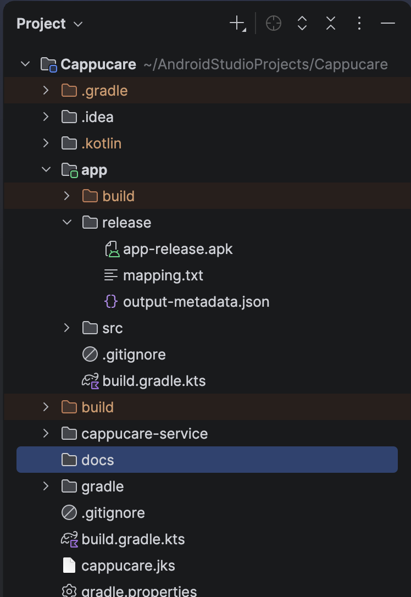

# Cappucare 📦💊

Aplicación móvil Android para el control inteligente y oportuno de existencias de productos e insumos médicos, desarrollada como proyecto semestral de la asignatura **DSY1105 – Desarrollo de Aplicaciones Móviles** (Duoc UC, Escuela de Informática y Telecomunicaciones, CITT San Bernardo).

La solución tiene dos partes: la app Android (`app/`) y un microservicio REST con Spring Boot (`cappucare-service/`) con el que la app sincroniza productos y movimientos mediante Retrofit.

> ⚠️ **Prototipo funcional académico.** Todos los datos (productos, movimientos, ventas, usuarios) son ficticios. No se conecta a sistemas productivos de Cappucare.

---

## 📌 Contexto del caso

Cappucare vende productos e insumos médicos y necesita mantener un control preciso de sus existencias. Hoy la información puede quedar distribuida o desactualizada, lo que genera diferencias entre el stock registrado y el real, omisiones en movimientos, quiebres de stock y compras innecesarias.

**Objetivo de la app:** que el personal autorizado pueda, desde un dispositivo Android:
* Consultar la disponibilidad real de cada producto.
* Registrar ingresos y salidas (ventas) con trazabilidad.
* Detectar anticipadamente productos con stock bajo o próximos a vencer.
* Identificar productos rápidamente mediante códigos QR / de barras con la cámara.
* Mantener el inventario sincronizado con un servidor central (microservicio).

---

## ✨ Funcionalidades

| Módulo | Descripción |
| :--- | :--- |
| **Inicio de sesión** | Pantalla de acceso con correo y contraseña (acceso simulado en este prototipo). |
| **Inicio (Home)** | Saludo al usuario, alerta de productos con stock bajo, resumen de inventario y accesos rápidos. |
| **Inventario** | Listado de productos con búsqueda (nombre, SKU o código de barras), filtro por categoría y resumen. Acciones rápidas: *Registrar venta* o *Pedir reposición* según el nivel de stock. |
| **Detalle de producto** | Ficha completa: información general, lotes y vencimientos, información médica (indicaciones, dosis, contraindicaciones) e historial de movimientos del producto. Permite editar y eliminar. |
| **Registro de movimientos** | Ingreso o salida (venta) con cantidad, motivo y responsable. Valida que no se pueda dejar el stock en negativo y envía el movimiento al microservicio. |
| **Agregar / editar producto** | Formulario con validaciones por campo, listas desplegables (categoría y unidad), selector de fecha de vencimiento y número de lote. |
| **Escáner** | Lectura de códigos QR, EAN-13 y EAN-8 con CameraX + ML Kit, linterna y entrada manual del código. Si el producto no existe, ofrece registrarlo con el código ya cargado. |
| **Historial** | Registro de todos los movimientos con búsqueda y filtro por categoría. |
| **Perfil** | Datos del usuario, actividad y cierre de sesión con confirmación. |

### Reglas de negocio implementadas
* Un SKU es único; no se pueden registrar dos productos con el mismo código.
* Una salida no puede superar el stock disponible (regla validada en la app y también en el microservicio).
* Un producto está en stock bajo cuando `stock <= stock mínimo`.
* Estado de vencimiento: **vigente**, **por vencer** (dentro de 60 días) o **vencido**.
* Cada movimiento queda registrado con fecha, tipo (ingreso/salida), cantidad, motivo y responsable.
* Los cambios de stock y el registro del movimiento se guardan en una transacción (ambos o ninguno).

---

## 🏗️ Arquitectura

El proyecto sigue el patrón **MVVM** con Jetpack Compose y Material 3.

```text
┌──────────────────────────┐   Retrofit (HTTP/JSON)   ┌────────────────────────────┐
│  App Android (Compose)   │ ───────────────────────► │  cappucare-service         │
│  MVVM + Room (local)     │ ◄─────────────────────── │  Spring Boot + JPA + H2    │
└──────────────────────────┘                          └────────────────────────────┘
```

La app guarda siempre primero en Room (base local) y luego intenta sincronizar con el servidor, por lo que también funciona sin conexión.

```text
app/src/main/java/com/duoc/cappucare/
├── MainActivity.kt
├── data/                  # Capa de datos (Room)
│   ├── AppDatabase.kt
│   ├── CappucareDao.kt
│   ├── ProductEntity.kt
│   ├── MovementEntity.kt
│   ├── LotEntity.kt
│   ├── model/             # Modelos de API externa (GlobalHealthStats)
│   └── remote/            # Retrofit: comunicación con el microservicio y API externa
│       ├── ApiClient.kt         # Cliente Retrofit + OkHttp (BASE_URL)
│       ├── CappucareApi.kt      # Contrato de endpoints del microservicio
│       ├── ApiModels.kt         # DTOs y mapeos entidad <-> DTO
│       ├── HealthApiService.kt  # Contrato de endpoints de API externa
│       └── RetrofitInstance.kt  # Instancia Retrofit para API externa
├── model/
│   └── ProductForm.kt     # Estado, errores y validaciones del formulario
├── repository/
│   └── HealthRepository.kt
├── viewmodel/
│   ├── CappucareViewmodel.kt      # Estado global: productos, stock bajo, movimientos y sincronización
│   ├── ProductFormViewModel.kt    # Lógica del formulario agregar/editar
│   └── HealthViewModel.kt         # Estado de consulta a la API externa
└── ui/
    ├── components/        # Componentes reutilizables (AppLogoHeader)
    ├── navigation/        # AppNavHost (rutas) y AppBottomBar
    ├── screens/           # Login, Home, Inventory, ProductDetail, ProductForm,
    │                      # Scanner, History, Profile
    └── theme/             # Color, Type, Theme
```

**Flujo de datos:** `Room (DAO) → Flow → ViewModel (StateFlow) → collectAsState() → Composable`.

### Modelo de datos
* **`products`**: `sku` (PK), `nombre`, `categoría`, `stock`, `stock mínimo`, `ubicación`, `vencimiento`, `código de barras`, `precio`, `marca`, `unidad`, `imagen`, `indicaciones`, `dosis` y `contraindicaciones`.
* **`movements`**: `id`, `productSku` (FK), `fecha`, `tipo` (`INGRESO` / `SALIDA`), `cantidad`, `motivo` y `responsable`.
* **`lots`**: `id`, `productSku` (FK), `número de lote`, `vencimiento`, `cantidad` y `ubicación`.

Las relaciones usan `ON DELETE CASCADE`: al eliminar un producto se eliminan sus lotes y movimientos.

---

## 🌐 Microservicio Spring Boot (`cappucare-service`)

API REST en Kotlin + Spring Boot 3.5 que centraliza el inventario. Usa Spring Web, Spring Data JPA, Bean Validation y una base de datos H2 en memoria.

```text
cappucare-service/src/main/kotlin/com/duoc/cappucareservice/
├── CappucareServiceApplication.kt
├── DataSeeder.kt               # Carga los 5 productos de ejemplo al iniciar
├── controller/Controllers.kt   # ProductController y MovementController
├── service/InventoryService.kt # Reglas de negocio (el stock no puede quedar negativo)
├── repository/Repositories.kt
└── model/                      # Product y Movement (entidades JPA) + MovementRequest
```

### Endpoints del Microservicio

| Método | Ruta | Descripción | Respuestas |
| :--- | :--- | :--- | :--- |
| `GET` | `/api/products` | Lista de productos | `200` |
| `GET` | `/api/products/low-stock` | Productos con `stock <= stock mínimo` | `200` |
| `GET` | `/api/products/{sku}` | Detalle de un producto | `200 · 404` |
| `POST` | `/api/products` | Crear producto | `201 · 400 (validación) · 409 (SKU existente)` |
| `PUT` | `/api/products/{sku}` | Actualizar producto | `200 · 404` |
| `DELETE` | `/api/products/{sku}` | Eliminar producto y sus movimientos | `204 · 404` |
| `GET` | `/api/movements?sku=` | Lista de movimientos (filtro opcional por SKU) | `200` |
| `POST` | `/api/movements` | Registrar `INGRESO` o `SALIDA` | `201 · 400 · 404 · 422 (stock insuficiente)` |

### Ejecutar el microservicio

**Requisitos:** JDK 17 o 21. *(⚠️ El microservicio usa Gradle 8.14 y Kotlin 2.1, que no son compatibles con JDK 25: si el equipo tiene JDK 25, apunta `JAVA_HOME` a un JDK 21 antes de ejecutar).*

```powershell
cd cappucare-service

# Solo si tu JDK por defecto es 25 (ajusta la ruta a tu JDK 21):
$env:JAVA_HOME = "C:\Program Files\Eclipse Adoptium\jdk-21.0.13.10002-hotspot"
$env:Path = "$env:JAVA_HOME\bin;$env:Path"

.\gradlew.bat bootRun        # Linux/macOS: ./gradlew bootRun
```

El servidor queda listo en `http://localhost:8080` cuando aparece `Started CappucareServiceApplication`.
* **API:** `http://localhost:8080/api/products`
* **Consola H2:** `http://localhost:8080/h2-console` (JDBC URL `jdbc:h2:mem:cappucare`, usuario `sa`, sin contraseña)
* Los datos están en memoria: se reinician al detener el servidor.

Para generar el JAR: `.\gradlew.bat bootJar` y luego `java -jar build/libs/cappucare-service-0.0.1.jar`.

### Probar la API

En PowerShell:

```powershell
# Ver un producto
Invoke-RestMethod http://localhost:8080/api/products/CAP-MED-001

# Registrar una venta
Invoke-RestMethod -Method Post -Uri http://localhost:8080/api/movements -ContentType "application/json" -Body '{"productSku":"CAP-MED-001","type":"SALIDA","quantity":1,"reason":"Venta","responsible":"Camilo"}'

# Ver los movimientos
Invoke-RestMethod http://localhost:8080/api/movements
```

> En PowerShell `curl` es un alias de `Invoke-WebRequest`; usa `Invoke-RestMethod` o `curl.exe`.

---

## 🔗 Integración app ↔ microservicio (Retrofit)

* `ApiClient` configura Retrofit + OkHttp (timeouts de 5 s de conexión y 10 s de lectura) con conversor Gson.
* `CappucareApi` declara los endpoints del microservicio como funciones `suspend`.
* Al iniciar la app, `syncFromServer()` descarga los productos del servidor y los guarda en Room. Se muestra el mensaje `"Sincronizado con el servidor (N productos)"`.
* Al registrar una venta o un ingreso, el movimiento se guarda primero en Room (transacción) y luego se envía con `POST /api/movements`.
  * **Resultado visible para el usuario:**
    * `"Movimiento registrado y sincronizado"`: el servidor lo recibió.
    * `"Movimiento registrado (solo local: …)"`: no hubo conexión o el servidor lo rechazó. El dato queda en el dispositivo y el mensaje indica la causa (código HTTP o tipo de error).
* **Recuperación automática:** si el servidor no conoce el producto (`404`) o tiene un stock distinto (`422`), la app deja el producto del servidor igual al local y reintenta el movimiento una vez.

### Dirección del servidor (`BASE_URL`)

Se define en `app/src/main/java/com/duoc/cappucare/data/remote/ApiClient.kt`:

| Dónde corre la app | `BASE_URL` |
| :--- | :--- |
| Emulador de Android Studio | `http://10.0.2.2:8080/` (valor por defecto) |
| Dispositivo físico (misma red WiFi que el PC) | `http://<IP-del-PC>:8080/` (ver con `ipconfig`) |
| Emulador con túnel `adb reverse` | `http://localhost:8080/` |

**Notas:**
* El manifiesto declara el permiso `INTERNET` y `usesCleartextTraffic="true"` porque el servidor local usa HTTP.
* Si la app muestra `SocketTimeoutException`, revisa que el servidor esté corriendo y que el firewall de Windows permita conexiones entrantes al puerto 8080.
* Con `adb reverse` (`adb reverse tcp:8080 tcp:8080`) hay que repetir el comando cada vez que se reinicia el emulador o se vuelve a instalar la app.

---

## 🌍 Consumo de API externa (Retrofit)

Además del microservicio propio, la aplicación consume la API pública **Disease.sh** mediante Retrofit (`RetrofitInstance.kt` y `HealthApiService.kt`) para obtener estadísticas globales de salud (`GlobalHealthStats`) sin interferir con los datos locales ni el inventario:

* **URL Base:** `https://disease.sh/`
* **Endpoint utilizado:**

| Método | Ruta | Descripción | Respuesta |
| :--- | :--- | :--- | :--- |
| `GET` | `v3/covid-19/all` | Obtiene estadísticas globales de salud (`GlobalHealthStats`) | `200 OK` |

---

## 🧰 Tecnologías

### App Android
* **Lenguaje:** Kotlin 2.1
* **UI:** Jetpack Compose + Material 3 (BOM 2026.02.01), Material Icons Extended
* **Navegación:** Navigation Compose 2.9.8
* **Persistencia local:** Room 2.6.1 (con KSP)
* **Estado:** ViewModel + StateFlow / Flow
* **Red:** Retrofit 2.11.0 + OkHttp 4.12.0 + Gson
* **Cámara y escaneo:** CameraX 1.6.1 + ML Kit Barcode Scanning 17.3.0
* **Imágenes:** Coil 2.7.0
* **Android Gradle Plugin:** 9.4.1
* **SDK:** `minSdk 28` · `targetSdk / compileSdk 37`

### Microservicio
* Kotlin 2.1.10 · Spring Boot 3.5.7 · Spring Web · Spring Data JPA · Bean Validation
* Base de datos H2 (en memoria) · Gradle 8.14.3

---

## 🚀 Cómo ejecutar el proyecto

### Requisitos
* Android Studio actualizado (compatible con AGP 9.4.x)
* JDK 11 o superior para la app; JDK 17 o 21 para el microservicio
* Emulador (Device Manager) o dispositivo físico Android 9+ (API 28+)
* Para probar el escáner se recomienda un dispositivo físico con cámara

### Pasos
1. **Clonar el repositorio:**
   ```bash
   git clone [https://github.com/Matiasytorres/Ev2_Cappucare.git](https://github.com/Matiasytorres/Ev2_Cappucare.git)
   ```
2. **Levantar el microservicio** (ver *Ejecutar el microservicio*) y dejar esa terminal abierta.
3. Abrir la carpeta en Android Studio y esperar la sincronización de Gradle.
4. Seleccionar un dispositivo o emulador (y ajustar `BASE_URL` si es un dispositivo físico).
5. Ejecutar con **▶ Run 'app'**.
6. En la pantalla de acceso, pulsar **Iniciar Sesión** (el acceso es simulado).

> La app también funciona sin el microservicio: usa solo los datos locales y avisa que no hay conexión con el servidor. Al primer arranque la base de datos se carga automáticamente con productos de ejemplo ficticios (paracetamol, guantes de nitrilo, mascarillas, alcohol gel, jeringas), algunos con stock bajo para visualizar las alertas.

### Permisos
| Permiso | Uso |
| :--- | :--- |
| `INTERNET` | Comunicación con el microservicio y API externa. |
| `CAMERA` | Escaneo de códigos QR y de barras (se solicita al abrir el escáner). |
| `POST_NOTIFICATIONS` | Declarado para avisos de stock mínimo. |

---

## 🗺️ Estado del proyecto

Implementado: login simulado, navegación con barra inferior, inventario con búsqueda y filtros, detalle de producto, registro de movimientos con validación de stock, formulario con validaciones, escáner QR/códigos de barras, historial, perfil, persistencia local con Room, microservicio Spring Boot, consumo de API externa e integración Retrofit con sincronización de productos y movimientos, más suite de pruebas unitarias.

---

## 📦 APK Firmado y Llave (`.jks`)

El ejecutable de producción fue generado y firmado digitalmente mediante Android Studio utilizando el almacén de claves `cappucare.jks` configurado en `app/build.gradle.kts`:

* **APK firmado:** `app/release/app-release.apk`
* **Keystore:** `cappucare.jks`



---

## 👥 Equipo

| Integrante |
| :--- |
| **Camilo Peña** |
| **Matías Yáñez** |

* **Asignatura:** Desarrollo de Aplicaciones Móviles (DSY1105) — Sección 004D
* **Profesor:** José Miguel Candia
* **Repositorio GitHub:** [https://github.com/Matiasytorres/Ev2_Cappucare](https://github.com/Matiasytorres/Ev2_Cappucare) (ramas por feature y commits descriptivos de ambos integrantes)
* **Tablero Trello:** [Tablero Ev2 - Cappucare](https://trello.com/invite/b/6ad6744c26adca991b561b84/ATTI5ddc038ea35f1a01550a2a48796b7c26AFA2611F/ev2cappucare) (planificación distribuida: *Por hacer · En curso · Finalizado*)

---

## 📄 Licencia y uso

Proyecto con fines exclusivamente académicos. Todos los datos son ficticios o anonimizados y la aplicación no está destinada a publicación ni a uso en producción.
